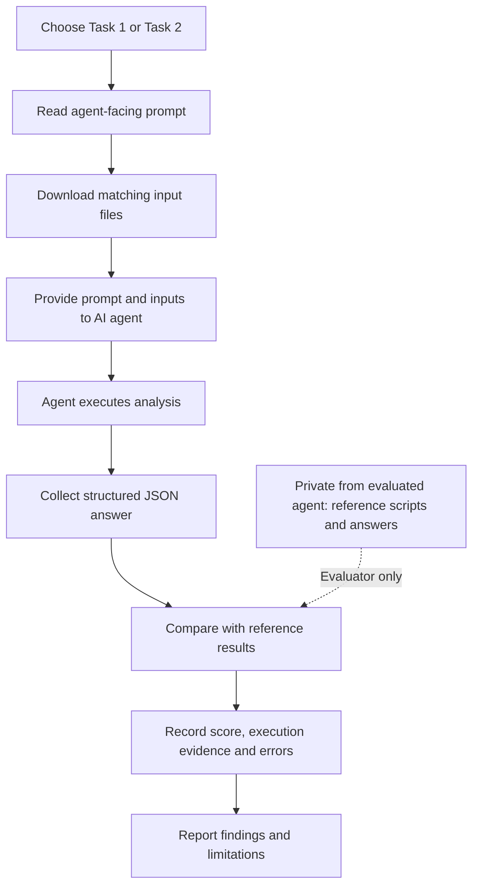

# MetaBench-AI

### Reproducible benchmarks for evaluating AI agents in metagenomics

**MetaBench-AI** is an open, research-oriented collection of data-dependent tasks for assessing whether AI agents can carry out scientifically defensible metagenomic analyses. Its initial development release focuses on compositional preprocessing, batch-effect evaluation, and confounder-aware microbial association analysis using multi-cohort colorectal cancer (CRC) microbiome data.

> **Scope:** This is a transparent *development and reproducibility benchmark*, not a validated, leakage-resistant leaderboard. Reference answers are public, and no systematic multi-model performance claims are made.

## 1. Rationale

Metagenomic data analysis is more than executing a bioinformatics pipeline. Species-abundance matrices are sparse and compositional; study-specific processing and sequencing factors can confound biological comparisons; and observational microbial associations require careful statistical interpretation. An AI agent can produce plausible-looking output while making consequential mistakes—for example, transforming data along the wrong axis, confusing a marginal batch effect with an independent effect, including an unintended disease group, or interpreting a model-adjusted association as causal proof.

MetaBench-AI turns these decisions into **verifiable, data-dependent evaluations**. Each task provides an input dataset, a precise scientific question, an expected machine-readable answer, and reference results obtained through a specified analysis. The goal is to assess both computational execution and scientific reasoning, while making limitations and methodological choices explicit.

The initial tasks draw on harmonized, species-level CRC metagenomic research datasets. They are **not raw sequencing-read benchmarks**; the starting point is a filtered TPM matrix for Task 1 and a previously processed CLR/batch-corrected matrix for Task 2.

## 2. How to use MetaBench-AI

The following workflow applies to an AI agent with access to local CSV files and an R or Python execution environment.



*Figure 1. Recommended MetaBench-AI evaluation workflow. Reference materials are used by the evaluator after the agent submits its answer, not supplied to the agent during analysis.*

### Step-by-step procedure

1. **Select a task.** Open the relevant file in [`Task_prompts/`](Task_prompts/) and read its full agent-facing instructions.
2. **Obtain the inputs.** Download only the files from the corresponding [`Task1_input/`](Task1_input/) or [`Task2_input/`](Task2_input/) directory. Preserve filenames and sample identifiers.
3. **Start an execution-capable AI session.** Use an agent that can inspect CSVs, write and execute the specified R or Python code, and report results. Supply the **prompt and matching inputs only**. Do not provide the ground-truth workbook or reference scripts.
4. **Collect the response.** Ask for the JSON structure specified in the task prompt, and retain execution logs or generated scripts where permitted.
5. **Evaluate the result.** Compare numerical fields with [`MetaBench_AI_Ground_Truth.xlsx`](MetaBench_AI_Ground_Truth.xlsx). For Task 1, use the proposed **±0.0001** tolerance for each R² and require the correct factor name. For Task 2, use the proposed **±0.002** tolerance for each point estimate; evaluate interval coverage statements separately. Confidence-interval endpoint tolerances are not yet established.
6. **Record reproducibility information.** Note the agent/model and version, execution date, software versions, input file revision or checksum, numerical outputs, whether code was actually run, and any observed errors.
7. **Report transparently.** Distinguish measured agent behavior from anticipated failure modes. Do not infer general model performance from one run.

### Example response format — Task 1

```json
{
  "task_id": "mgx_batch_effect_evaluation",
  "factor": "<factor name>",
  "r2_before": 0.0,
  "r2_after": 0.0
}
```

The numbers above are **placeholders**, not reference answers. For Task 2, follow the exact JSON schema in its prompt file.

## 3. Reproducibility and reference materials

Task 1's reference workflow uses R packages **limma**, **compositions**, **vegan**, and **dplyr**. Task 2's reference workflow uses Python packages **numpy**, **pandas**, **scikit-learn**, and **econml**. Use the reference scripts in the repository for the full method configuration and input orientation. A pinned environment and end-to-end verification against the published repository files remain to be completed.

**Important:** Task 2 uses its **own original V2 matrix**. Do **not** substitute the newly generated corrected matrix from Task 1: the two reference analyses were performed with different processed matrices.

Reference outputs are provided to support reproducibility, not as claims of universal biological ground truth. They should not be included in the evaluated agent's context. Because these materials are public, evaluations are vulnerable to answer retrieval or training-data contamination.

## 4. Development roadmap

Planned work includes: (i) a deterministic JSON grader with unit tests; (ii) pinned R/Python environments and automated reproducibility checks; (iii) complete cohort provenance and data-use documentation; (iv) measured evaluations of different AI agents; and (v) additional tasks in taxonomic and functional profiling, MAG quality assessment, and cross-cohort generalization.

## 5. Attribution, contributions, and citation

**Project maintainer:** AbdulAziz Ascandari. The analytical methods build on collaborative metagenomic research; acknowledge contributing researchers and original cohort data providers when reusing the work. Suggestions and issues are welcome via the repository's GitHub Issues page.

A formal software citation and archived release identifier are planned. Until then, cite the repository and the original datasets or related scientific publications as appropriate.

## 6. License

Original MetaBench-AI software and reference scripts are provided under the MIT License. Dataset access and redistribution conditions may differ and are not superseded by the software license.

---

*MetaBench-AI is an evolving research resource for transparent, reproducible evaluation of scientific AI agents in metagenomics.*
